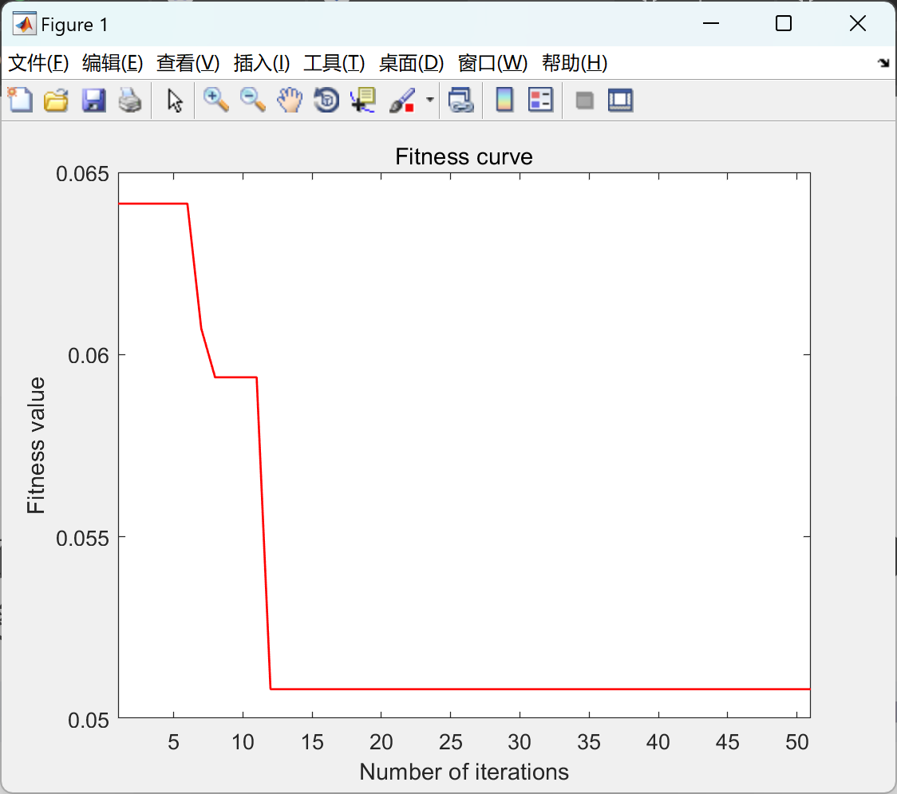

# Surface Roughness Optimization Based on Particle Swarm Optimization Algorithm - Study of Surface Roughness Using Backpropagation Neural Network (Matlab Code)

[Surface Roughness]Optimization of Surface Roughness Based on Particle Swarm Optimization Algorithm - Study on Surface Roughness by Backpropagation Neural Network (Matlab Code)
In the study of surface roughness, utilizing the Particle Swarm Optimization algorithm (PSO) to optimize the Back Propagation Neural Network (BPNN) is an effective method aimed at enhancing the accuracy and efficiency of model predictions. The following outlines a research framework and steps based on this approach:
1. Problem definition and data collection define the problem: to clearly define the research objective is to predict or optimize the surface roughness during the processing process.
Data Collection: Collect various parameters related to surface roughness, such as cutting speed, feed rate, cutting depth, tool material, workpiece material, etc.
2. Data preprocessing and cleaning: Remove outliers, missing values, etc.
Feature selection: Select features that have a significant impact on surface roughness.
Data normalization: Scaling feature data to a common scale, typically using min-max normalization or Z-score normalization.
3. Construct a BP neural network model to determine the network structure: including the number of neurons in the input layer, hidden layer (possibly multiple), and the number of neurons in the output layer.
Activation Function Selection: Common activation functions include Sigmoid, ReLU, etc. Choose the appropriate activation function based on the characteristics of the problem.
Initialize weights and biases: Randomly initialize network parameters.
4. Particle Swarm Optimization Algorithm (PSO) initializes the particle population: each particle represents a set of weights and biases for a BP neural network, with random initialization of particle positions and velocities.
Fitness function: Define a fitness function to evaluate the performance of each particle. Typically, the prediction error on the validation set (such as MSE, RMSE, etc.) is used as the fitness value using a BP neural network.
Update particle positions and velocities: Update the particle's position and velocity based on its current position, individual history-optimal position, global optimal position, and the velocity update formula.
Iterative Optimization: Repeat the fitness evaluation, update position and velocity until the preset number of iterations or other stopping conditions are met.
5. Model Training and Validation: Use PSO-optimized parameters of a BP neural network for training.
Dataset Partitioning: Divide the dataset into training set, validation set, and test set.
Training the Model: Train the model on the training set.
Validating the Model: Evaluate the model performance on the validation set, adjusting model parameters (such as network structure, learning rate, etc.).
Testing the Model: Test the generalization ability of the model on the test set.
6. Results Analysis and Discussion: Performance Evaluation: Analyze the prediction performance of the model on the test set, such as prediction accuracy, error distribution, etc.
Parameter Sensitivity Analysis: Discuss the impact of different parameters on model performance.
Comparative Experiments: Compare with unoptimized BP neural networks, other machine learning models to evaluate the advantages of PSO-BPNN.
7. Conclusion and Prospects: Summarize the effectiveness and advantages of PSO-BPNN in surface roughness prediction.
Propose Improvement Directions: Address the issues and deficiencies found in the research, propose future research directions and improvement measures.

## Images

<!-- PAYMENT_BLOCK -->

## Get this dataset

- Payment link (Stripe): [Buy now](https://buy.stripe.com/3cs8yP7sY87d0vu9AB)
- Payment QR code: 

<!-- /PAYMENT_BLOCK -->
